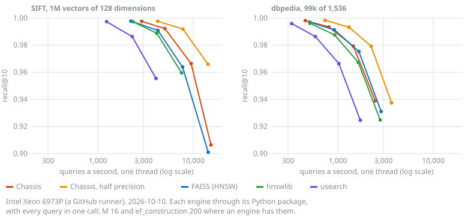

# Performance

How fast Chassis searches and builds, against hnswlib and FAISS, with the machines, the data and
the commands to measure it yourself.

## Summary

On GitHub's server runners on 2026-10-19 (AMD EPYC Zen 3, 4 and 5, Intel Xeon, Arm Neoverse-N2),
Chassis 0.10.0 as `pip` installs it against hnswlib 0.8.0 and FAISS 1.15.1, each through its
Python package with every query in one call (Chassis's `search_batch`), on one thread. Queries a
second for 0.95 recall@10, Chassis over the other engine, as the median of a CPU's jobs; the plan,
the checks and every job are in
[`bench/lab/compare-plan.md`](https://github.com/tanvincible/chassis/blob/lab/x86/bench/lab/compare-plan.md)
on the `lab/x86` branch. In brackets, Chassis opened with `warm`, which put the vectors on huge
pages where they are 2 KB or more.

**Full precision**

| Vectors | CPU (jobs) | Over hnswlib | Over FAISS's HNSW | Over FAISS with Panorama |
| --- | --- | --- | --- | --- |
| 128 dims × 1M | Zen 3 (4) | 1.12× | 1.00× | 1.28× |
| | Zen 5 (1) | 2.49× | 2.05× | 2.72× |
| | Neoverse-N2 (1) | 4.01× | 1.89× | 2.12× |
| 960 dims × 200k | Zen 4 (1) | 1.18× (1.34×) | 0.85× (0.97×) | 0.63× (0.72×) |
| | Neoverse-N2 (1) | 1.96× (2.10×) | 1.06× (1.14×) | 0.44× (0.48×) |
| 1,536 dims × 99k | Zen 3 (3) | 1.15× (1.30×) | 0.86× (0.99×) | 0.95× (1.09×) |
| | Xeon 6973P-C (1) | 1.05× (1.10×) | 0.93× (0.97×) | 0.97× (1.02×) |
| | Neoverse-N2 (1) | 2.50× (2.79×) | 0.99× (1.11×) | 0.87× (0.97×) |

**Half precision**

| Vectors | CPU (jobs) | Over hnswlib | Over FAISS's HNSW | Over FAISS with Panorama |
| --- | --- | --- | --- | --- |
| 128 dims × 1M | Zen 3 (4) | 1.62× | 1.43× | 1.85× |
| | Zen 5 (1) | 2.65× | 2.18× | 2.89× |
| | Neoverse-N2 (1) | 4.22× | 1.99× | 2.23× |
| 960 dims × 200k | Zen 4 (1) | 2.07× | 1.50× | 1.10× |
| | Neoverse-N2 (1) | 2.71× | 1.47× | 0.61× |
| 1,536 dims × 99k | Zen 3 (3) | 1.46× (1.57×) | 1.11× (1.20×) | 1.20× (1.30×) |
| | Xeon 6973P-C (1) | 1.42× (1.70×) | 1.26× (1.50×) | 1.32× (1.57×) |
| | Neoverse-N2 (1) | 3.10× (3.34×) | 1.23× (1.33×) | 1.08× (1.16×) |

- **Huge pages are most of FAISS's lead at long vectors.** FAISS's memory gets them from Linux
  without asking; Chassis's file gets them from `warm`, or from `huge_pages`
  ([ADR-0016](https://github.com/tanvincible/chassis/blob/main/docs/adr/016-huge-pages-on-request.md)).
  On CPUs with AVX-512 the rest was AVX-512, which Chassis uses after 0.10.0: with both, a lab
  version of its kernel made 1.01 to 1.04 times FAISS's queries a second at 1,536 dimensions on Zen
  4, Zen 5 and two Xeons
  ([ADR-0025](https://github.com/tanvincible/chassis/blob/main/docs/adr/025-avx-512.md)).
- **Panorama** keeps vectors in PCA order and stops a distance once it can't win. It gained most
  where a few components carry most of a vector, as in GIST's image descriptors. It was slower than
  FAISS's plain HNSW at 128 dimensions, and on x86 with the text embeddings for 0.95 recall.
- **Jobs where FAISS searched more than 5% faster or slower a second time are left out**, 8 of 21,
  which leaves GIST one x86 job. Counting them, Panorama was ahead of Chassis's fastest setting on
  GIST on Zen 3 (1.23×, three jobs) and on a Xeon 8370C (1.11×).

With one call per query instead of one for all, Chassis spends 13 to 26 µs a query outside the
library on server CPUs (2026-10-17); in one call it is within 5% of Rust.

Across search settings on a Xeon, in an earlier run (2026-10-10, without `warm` or Panorama):



[Comparison](./comparison.md) has Annoy, sqlite-vec and LanceDB too, with build times, file sizes
and cold starts.

**From a cold start**
([ADR-0019](https://github.com/tanvincible/chassis/blob/main/docs/adr/019-warm.md), Apple M5, 99,000
× 1,536 dims, the file not in memory): the first result came 0.11 s after the process started.
hnswlib, which loads its file first, gave its first at 0.5 to 0.8 s. With `warm()`, the hundredth
result came at 0.37 s instead of 1.9 s.

## Builds

Measured on 2026-10-07 on the same M5, which has 4 performance and 6 efficiency cores and was in
Low Power Mode, with other applications running. One build at a time, `M` 16, `ef_construction`
200; "every core" is Chassis's `add_batch` and hnswlib's `num_threads=-1`. Search is one thread.

| Dataset | Engine | One thread | Every core | Speedup | ef 64, every core: recall / QPS |
|---------|--------|------------|------------|---------|---------------------------------|
| SIFT-1M | Chassis | 545 s | 110 s | 5.0× | 0.968 / 4,111 |
| | hnswlib | 682 s | 131 s | 5.2× | 0.959 / 2,878 |
| dbpedia, 99k × 1536 | Chassis | 417 s | 176 s | 2.4× | 0.978 / 841 |
| | hnswlib | 596 s | 163 s | 3.7× | 0.970 / 481 |

Graphs built on every core reach the same recall as one-thread builds of either engine (within
0.002 from `ef` 32 up, and 0.007 below). Their QPS varied by up to 40% either way between single
passes, so these runs don't compare search speed. An earlier parallel dbpedia run the same day
took 159 s for Chassis and 158 s for hnswlib, so builds vary by about 10% between runs. The
1,536-dimension build scales less for both engines;
[ADR-0010](https://github.com/tanvincible/chassis/blob/main/docs/adr/010-parallel-batch-builds.md)
has the details.

A one-thread build of SIFT-1M peaked at 1.09 GB of memory, 0.51 GB of it the vectors the harness
holds, and one of dbpedia at 1.22 GB with 0.61 GB.

## Size

Each slot takes a 24-byte slot header, its vector, and a level-0 record of `8 + 4 × M0` bytes (136
with the defaults). The few nodes above layer 0 add `4 × M` bytes per extra layer in the upper heap,
about 4 bytes per vector on average. For 1M vectors with 768 dimensions that is 3.07 GB of vectors
and 0.16 GB of everything else; half precision halves the vectors. Built as above, SIFT-1M's file is
713 MB and dbpedia's 821 MB.

Segments double in size up to 256 MiB, so the file can be up to one segment longer than the data
written. That unused end is never written, and takes no disk where the file system keeps holes:
ext4, XFS and btrfs keep all of them, and APFS those of 16 MiB or more. On Linux the writer
allocates 1 MiB ahead of what it writes, so that a full disk is an error, not a crash. On APFS,
files as long as SIFT-1M's and dbpedia's took 688 and 630 MB of disk. A backup keeps the holes
too.

## Deletes

A search still walks through deleted vectors, to keep the graph connected, so deletes cost speed
and space but not recall. With half the vectors deleted, searches ran at about 70% of their speed,
and with 90% deleted at a fifth. `compact()` gives the speed back
([ADR-0011](https://github.com/tanvincible/chassis/blob/main/docs/adr/011-compaction.md)).

## Scale

Ten million vectors of 128 dimensions with the default options, on one GitHub runner (AMD EPYC
Zen 4, 4 vCPUs, 15 GB) on 2026-10-20: a file of 6.9 GB. The vectors were made up, points around
1,000 centers in 16 dimensions projected to 128, so their recall says nothing about real
embeddings'. Every step ran without an error, and `check` found one vector that no path reaches,
which a search through the graph can't return until `compact` builds the graph again, as it did
here.

| Step | Took |
| --- | --- |
| Build, on every core | 20 minutes; each million took longer, 52 s the first and 149 s the tenth |
| Search, one thread | `ef` 64: recall@10 0.988 at 8,859 queries a second; `ef` 256: 0.999 at 3,015 |
| Open | under 0.01 s as a reader or a writer; 6 s after a writer was killed mid-add |
| `check` | 4 s |
| Delete 100,000; add 99,000 | 0.9 s; 67 s, 10,000 at a time, each flushed |
| `backup` | 17 s, keeping the file's holes |
| `compact` | 18.5 minutes; at its peak 12.5 GB in memory, nearly all of it the two files, though a later run held it to 1.2 times one file at the build's speed |

Memory besides the file's pages, sampled after each million added, peaked at 534 MB, 512 MB of
it the million vectors being added.

The same index in a cgroup with 2 GB of memory, a third of the file, gave the same results, but
at 5 queries a second, and took 2 adds a second, with most of the index on the runner's disk.
`warm` didn't help, as it can't keep more than fits. How much a faster disk helps wasn't
measured. Keep an index within the memory it has, or shrink it with half precision
([ADR-0018](https://github.com/tanvincible/chassis/blob/main/docs/adr/018-half-precision.md)): each
vector also takes about 164 bytes for its links and header at the default `M`, so half precision
takes 62% of the room at 128 dimensions, and nearly half from 768 ([Limits](../guide/limits.md)).
Building or compacting one larger than memory is out of reach at that rate: a million adds would
take nearly a week. The plan, the predictions and every number are in
[`bench/lab/scale-plan.md`](https://github.com/tanvincible/chassis/blob/lab/x86/bench/lab/scale-plan.md)
on the `lab/x86` branch.

## History

Measurements of file format 2, before v0.7.0, are in the decision records that each change came
with, and in [this page's history](https://github.com/tanvincible/chassis/commits/main/docs/src/architecture/performance.md).

## Reproduce

```bash
# Against hnswlib and usearch (downloads about 1.9 GB of datasets)
pip install numpy h5py pyarrow hnswlib usearch
python bench/ann/prepare.py
cargo run --release --example ann -- bench/ann/data sift-128          # add `batch` for every core
python bench/ann/reference_bench.py hnswlib bench/ann/data sift-128   # add `0` for every core
python bench/ann/reference_bench.py usearch bench/ann/data sift-128
```

[Benchmarking](../dev/benchmarking.md) has the other harnesses, and how to measure fairly.
